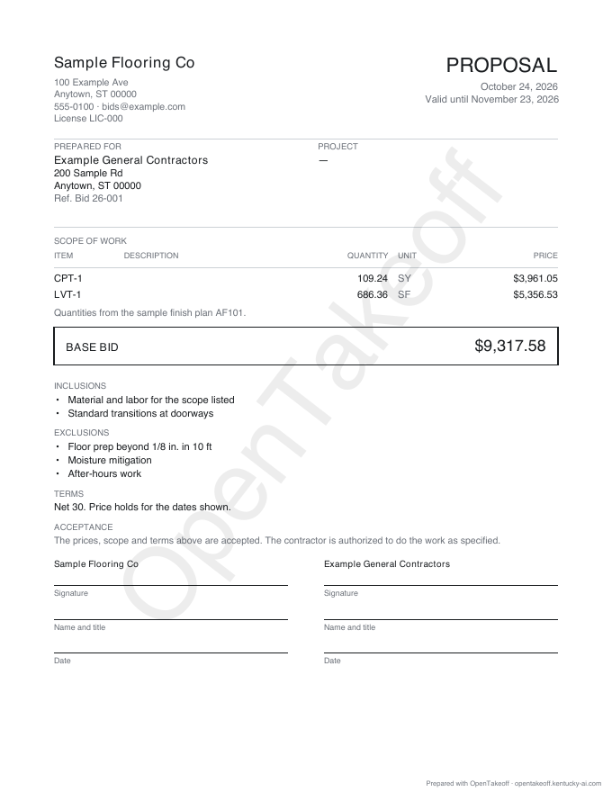
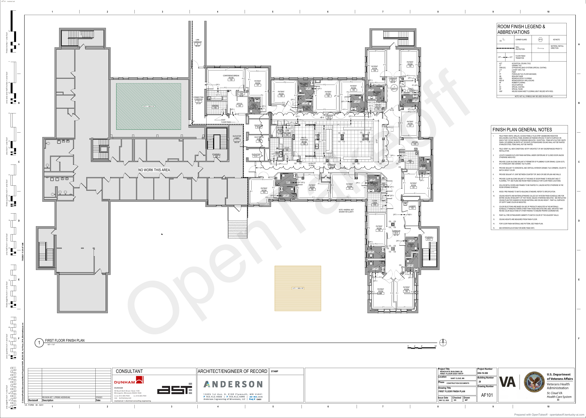
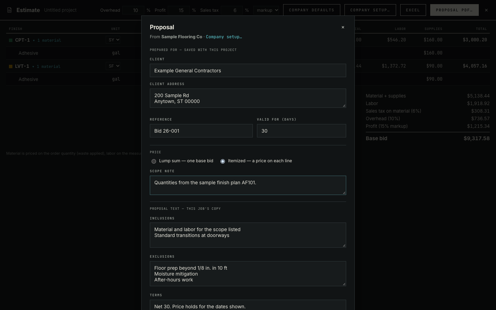

# Bid proposal PDF

**Estimate → Proposal PDF…** downloads a letter-size bid proposal. This fork does not stamp a diagonal OpenTakeoff or `OT_WATERMARK` on the proposal, the marked set, or the printed report. Company, client and prices in these images are placeholders. The PNGs and [results.json](results.json) are the upstream capture from 2026-10-24, which still shows that stamp; `web/scripts/verify-bid-proposal.mjs` and `web/test/bidProposal.test.ts` now assert it is absent.

| Proposal (itemized) | Marked set sheet |
|---|---|
|  |  |

The itemized lines ($3,961.05 + $5,356.53) add to the base bid ($9,317.58). The base bid is the engine's total on the saved project: the script checks the PDF's text against `priceEstimate` run on what IndexedDB holds.



## Reproduce

```bash
cd web
npm run dev -- --port 5191 --strictPort &
PLAYWRIGHT_MODULE=/path/to/playwright/index.mjs node --import tsx scripts/verify-bid-proposal.mjs ../docs/review/bid-proposal http://localhost:5191/
```

`pdftoppm` (poppler) renders the pages when it's installed.

Observed on 2026-10-24 (Node 24.18.0, headless Chrome): 20 of 20 checks passed ([results.json](results.json)). The run does a real takeoff on the sample (the plan's own scale, two Area traces), then prices it completely. The checks:

- The dialog copies the proposal text from Company setup.
- A job-only exclusion is saved with the project and doesn't reach Company setup.
- The client is saved with the project.
- The PDF's text holds the company, license, client, reference, the engine's base bid, the job-only exclusion, terms and scope note.
- The proposal PDF has no OpenTakeoff watermark and no `OT_WATERMARK`.
- The report's print strip has no `OT_WATERMARK`.
- The marked set from the Report has no `OT_WATERMARK` on any page.
- No page errors.

| Command | Expected | Observed |
|---|---|---|
| `node --import tsx --test test/bidProposal.test.ts` (allocation to the cent, model, sanitizer, PDF text on one and three pages with no watermark, broken logo, wrap with line breaks, marked set including a shop-drawing sheet in default and clear-label mode) | pass | see this fork's test run |
| `npm run check --prefix web` | pass | pass (3,568 tests, 0 failed) |
| `npm test --prefix mcp` | pass | 286/286 |
| `npm run check --prefix protocol` | pass | 61/61 |
| `check:tool-count`, `check:wiki`, `check:protocol-resources` (mcp) | pass | pass |
| `node scripts/check-doc-links.mjs` | OK | OK |
